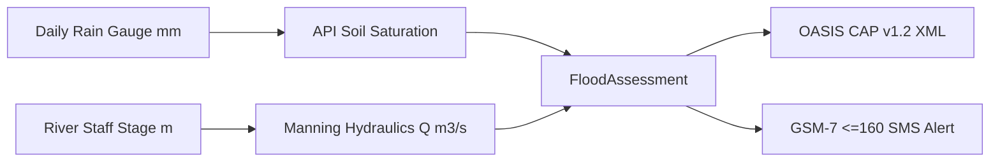

# floodcap-ew

[](https://github.com/codesphere-u/floodcap-ew/actions/workflows/ci.yml)
[](LICENSE)
[](pyproject.toml)
[](pyproject.toml)

**River-basin flood & flash-flood early-warning engine: Antecedent Precipitation Index (API), Manning open-channel stage-discharge hydraulics, OASIS CAP v1.2 XML alerts, and GSM-7 SMS evacuation advisories.**

- **Mission Domain:** Climate Adaptation & Disaster Early Warning
- **Stack:** Pure Python 3.11+ (zero runtime third-party dependencies, `mypy --strict`, `ruff`, `pytest`)
- **Maintainer:** Codesphere Innovations (U) Limited (`codesphere-u`)

---

## Problem Solved

Flash-flood prone catchments (such as Mount Rwenzori / River Nyamwamba and East African highlands) need lightweight offline early-warning engines that turn local rain-gauge and river-staff readings into standards-compliant CAP v1.2 XML and SMS evacuation warnings.

## Key Features

- Antecedent Precipitation Index (`API`) soil-saturation decay modeling (`compute_antecedent_precip_index`).
- Trapezoidal Manning open-channel stage-discharge hydraulics (`manning_discharge_m3_s`).
- 4-tier WMO flood severity classifier (`Minor`, `Moderate`, `Severe`, `Extreme`) generating valid OASIS Common Alerting Protocol (CAP v1.2) XML and `<=160`-char GSM-7 SMS community alerts.

## Architecture Overview



See [docs/architecture.md](docs/architecture.md) for module-level design details.

## Installation

```bash
git clone https://github.com/codesphere-u/floodcap-ew.git
cd floodcap-ew
uv sync --extra dev
```

Or install in editable mode with standard `pip`:

```bash
pip install -e ".[dev]"
```

## Quick Start (CLI)

```bash
floodcap-ew demo
floodcap-ew demo --xml
```

## Quick Start (Python API)

```python
from floodcap_ew import RiverCrossSection, assess_flood_risk, render_cap_v12_xml

sec = RiverCrossSection("ST-1", "River Nyamwamba", 14.0, 1.5, 0.004, 0.038, 3.2, 4.0)
res = assess_flood_risk(sec, current_stage_m=4.1, recent_daily_rain_mm=[30.0, 75.0])
assert "urn:oasis:names:tc:emergency:cap:1.2" in render_cap_v12_xml(res)
```

## Testing & Quality Gates

```bash
uv run ruff check src tests
uv run mypy src
uv run pytest -v
```

## Security, Contributing & Roadmap

- **Security:** See [SECURITY.md](SECURITY.md) for responsible disclosure procedures.
- **Contributing:** See [CONTRIBUTING.md](CONTRIBUTING.md) and [CODE_OF_CONDUCT.md](CODE_OF_CONDUCT.md).
- **Changelog & Roadmap:** See [CHANGELOG.md](CHANGELOG.md) and [ROADMAP.md](ROADMAP.md).

## License

MIT License — see [LICENSE](LICENSE).

## Support & Contact

Open an issue on [GitHub Issues](https://github.com/codesphere-u/floodcap-ew/issues) or contact `codesphereinnovationz@gmail.com`.
